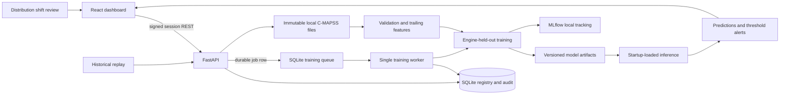

# Architecture

Training requests are written to SQLite before returning and claimed by a separate worker. A worker restart re-queues interrupted work; job IDs on candidates let a retry complete an already registered model without creating a duplicate. Training uses only complete train trajectories. The holdout is by engine ID, and rolling features use current and prior observations from that engine. The official test split is evaluated only after model activation, using the final observed test cycle and its supplied RUL. Inference runs in the API process and does not train inside a prediction request. A new training run registers a candidate; promotion requires an explicit approval request and preserves the prior active model for rollback.

The default local demo trains a deterministic HistGradientBoosting model from generated trajectories. Dataset import keeps NASA files separate and does not claim that demo metrics are NASA results. The dashboard uses request-response polling for its replay demonstration; it is not a real-time industrial telemetry transport. Replay histories and positions are persisted in SQLite so service restarts do not discard active sessions.

## Deployment boundary

Production Compose uses one API process and one worker on a local filesystem with SQLite WAL. Admin access uses an expiring signed cookie, origin checks, and login throttling. The built-in deployment is a single-host research service; scaling to multiple hosts requires shared transactional storage, a distributed job queue, shared artifact storage, and an external identity provider. C-MAPSS is simulated turbofan data, so this service is not validated for maintenance decisions or equipment control.

## Process boundaries

- `backend/app/data.py`: format parsing, integrity checks, deterministic demo trajectories, labels, and causal trailing features.
- `backend/app/ml.py`: classical baselines, optional LSTM, evaluation metrics, experiment files, artifact loading, and prediction.
- `backend/app/main.py`: session protection, request limits, API schemas, dataset versions, replay controls, alerts, monitoring, registry promotion and rollback.
- `backend/app/worker.py`: durable training job claiming and candidate training.
- `backend/app/db.py`: local SQLite persistence.
- `frontend/src/App.tsx`: eight workspace views and API-backed flows.
